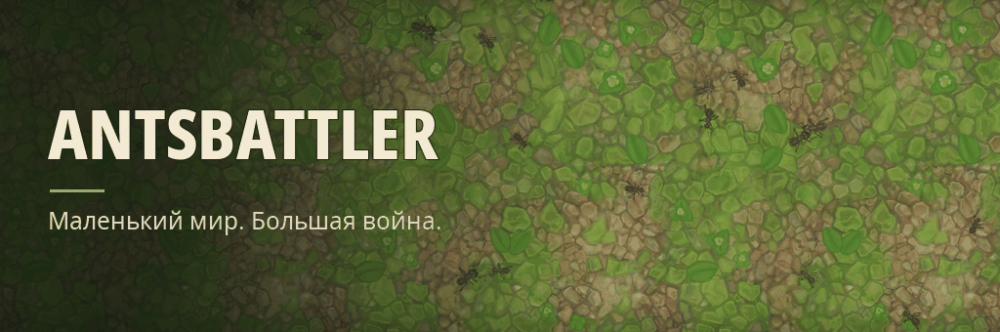
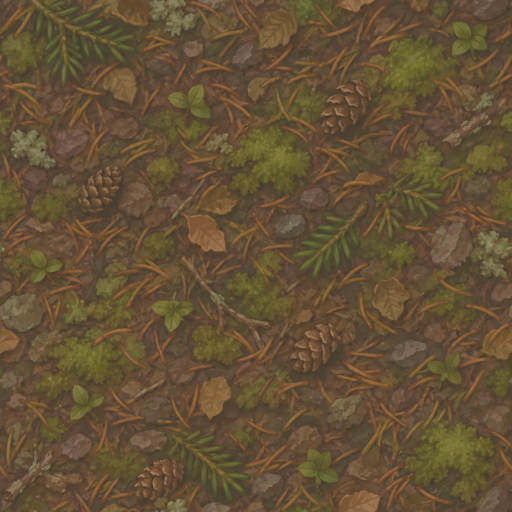
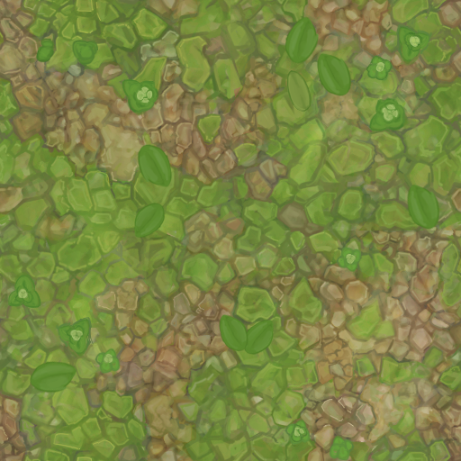
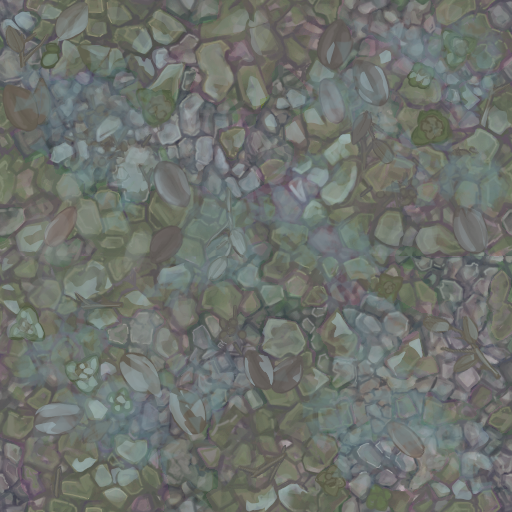
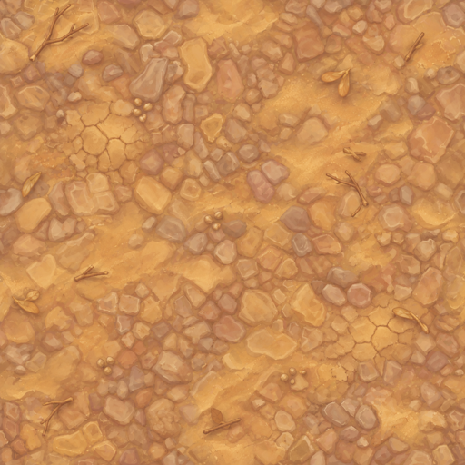
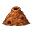
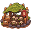

<div align="center">
  
  <p>
    
    
    
    
  </p>
  <p><a href="#об-игре">Об игре</a> · <a href="#игровые-механики">Механики</a> · <a href="#запуск">Запуск</a> · <a href="#управление">Управление</a></p>
</div>

## Об игре

**ANTSBATTLER** — двумерная пошаговая стратегия о жизни и борьбе муравьиных колоний. Игрок управляет отрядами на гексагональной карте, строит здания, накапливает ресурсы и сражается с другими муравьями и пауками.

На стратегической карте важны местность, состав армии и оставшиеся очки передвижения. В сражении каждый боец действует самостоятельно: выбирает цель, сближается с противником и атакует.

Здесь даже несколько сантиметров территории могут стать причиной полномасштабной войны.

## Игровые механики

- **Пошаговое передвижение.** Разные типы местности требуют разного количества очков передвижения.
- **Управление отрядами.** Можно просматривать состав, объединять отряды и разделять их на несколько групп.
- **Автоматические сражения.** Каждый боец имеет собственную позицию, здоровье, урон и броню. Бойцы выбирают цели и стараются не накладываться друг на друга.
- **Экономика и строительство.** Дерево и камень расходуются на здания; построенные объекты производят ресурсы при смене хода.
- **Редактор карты.** Типы провинций можно изменять и сохранять непосредственно в игре.
- **Анимации.** Отдельные покадровые анимации передвижения, атак и гибели, а также анимации усиков муравьёв.

## Игровой мир

Сражения происходят на полях, в лесах, горах и пустынях. На стратегической карте также встречаются пляжи и вода.

<table>
  <tr>
    <td align="center"><br><b>Лес</b></td>
    <td align="center"><br><b>Поля</b></td>
    <td align="center"><br><b>Горы</b></td>
    <td align="center"><br><b>Пустыня</b></td>
  </tr>
</table>

### Обитатели

| Вид | Назначение |
| --- | --- |
| Муравей-рабочий | Подвижный, но относительно слабый в бою |
| Муравей-солдат | Основная тяжёлая боевая единица |
| Паук | Одиночный противник с большим запасом здоровья |
| Тарантул | Более мощный и защищённый противник |

### Здания

<table>
  <tr>
    <td align="center"><br><b>Муравейник</b><br>Дерево, камень и 60 ячеек для бойцов</td>
    <td align="center"><br><b>Ферма</b><br>Производство дерева</td>
    <td align="center"><br><b>Каменоломня</b><br>Производство камня</td>
  </tr>
</table>

## Запуск

Для запуска необходимы Python и библиотека Pygame. Откройте терминал в корневой папке проекта:

```powershell
python -m pip install pygame
python PyGame_MAIN.py
```

Шрифты Russo One и PT Sans используются в интерфейсе; при их отсутствии игра использует системную замену.

## Управление

| Действие | Управление |
| --- | --- |
| Выбор отряда, перемещение и строительство | ЛКМ |
| Подтверждение атаки | Повторный клик по противнику |
| Контекстное меню своего отряда / отмена выбора | ПКМ |
| Следующий ход | `N` |
| Включение и выключение редактора карты | `F2` |
| Выбор типа местности в редакторе | `1`–`6` |
| Сохранение карты в редакторе | `F5` |
| Закрытие открытого меню, где предусмотрено | `Esc` |

---

<div align="center">
  <sub>Учебный проект в активной разработке. Муравьи не гарантируют соблюдение ваших стратегических планов.</sub>
</div>
